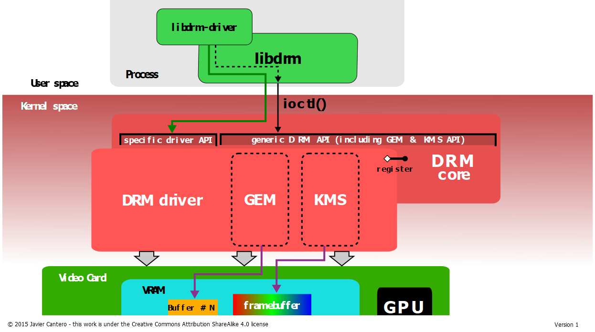
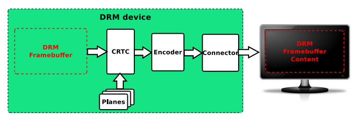

## DRM显示子系统

### 核心概念

------

**DRM 主要由三部分组成：libdrm、KMS、GEM**



**libdrm**：对各种ioctl接口的封装，直接提供给用户空间操作底层drm的接口

**KMS（Kernel Mode Setting）**：和GEM同属于kernel空间，主要负责**更新画面和设置显示参数**

**GEM（Graphic Execution Manager）**：主要**负责显示buffer的分配和释放**，也是GPU唯一用到DRM的地方。

------



**Framebuffer**：DRM子系统中也有Framebuffer的概念，即帧缓冲，用于存储待显示的图像数据。在传统的fb框架中，Framebuffer也是一个核心部分，不过fb框架比较简单，直接通过写Framebuffer就可对显示内容进行操作。在DRM子系统中，是通过 Framebuffer、Plane、CRTC 等对象协同管理显示内容


**Plane**：显示管线中的**图层**，负责指定使用哪一块图像数据，以及这块图像在屏幕上如何显示。

三种常见 Plane：

- Primary Plane： 通常承载显示画面的主要图层。
- Overlay Plane： 可承载额外的视频、图像或 UI 图层，具体用途取决于硬件。
- Cursor Plane： 专门用于硬件光标的图层。


**CRTC（Cathode Ray Tube Controller）**：CRTC是DRM管线中的**显示控制器**，负责按照设定的时序，将图像数据持续输出到屏幕。

- 显示时序： 按照设置的分辨率、刷新率等参数组织显示输出。
- 扫描输出： 驱动显示硬件按照规定的顺序读取图像数据，并输出每一帧画面。
- 显示管线配置： 与 Plane 等对象协同工作，确定当前显示管线如何输出画面。

例如，屏幕分辨率为 1920×1080，刷新率为 60 Hz，那么显示硬件需要以每秒 60 次的节奏输出完整画面。CRTC 负责的显示时序与扫描输出机制，是实现这一过程的重要部分。

应用层中最后会用**`drmModeSetCrtc`**（旧接口）这么一个关键函数，来进行画面显示。该函数选择对应显示控制器，读取framebuffer，根据connector模式信息，将画面输出到该的connector上。


**Encoder**：负责将CRTC输出的timing时序转换成外部设备所需要的信号的模块，如HDMI转换器或DSI Controller


**Connector**：用来描述**显示连接器对象**，描述的信息包括：

- 显示输出连接到了什么类型的显示设备（如HDMI, DSI...）

- 当前连接状态

- 显示模式信息（水平/垂直像素长度，像素时钟频率，刷新率等等）

应用层一般用**`drmModeConnector`**结构体来描述。


**屏幕相关基础概念**

**扫描**：CRTC 执行扫描，就是从 framebuffer 中读取图像数据，并按照逐行、逐像素（从上到下、从左到右）的顺序输出到屏幕面板上显示的过程。

**vblank **：Vertical Blanking，**垂直消隐**。显示器完成一帧图像扫描输出之后，到开始扫描下一帧图像之间的一段时间

**VSYNC**：Vertical Synchronization，**垂直同步**。让图像的更新与显示器的刷新周期保持同步，避免新旧两帧图像在同一次屏幕刷新过程中混合显示

一般是在 vblank 期间，更新扫描（切framebuffer，crtc提交显示），从而保证 VSYNC


### 应用层libdrm

drm的应用层调用实现都封装在libdrm里面，主要有两种接口方式，现代多采用atomic接口，如`drmModeAtomicCommit`等，老版本的旧接口如 `drmModeSetCrtc / drmModePageFlip` 已经逐步被atomic接口所替代。

> linux-demo/drm/modeset-atomic-plane.c

<<< ../external/linux-demo/drm/modeset-atomic-plane.c

#### drm设备节点

以上为atomic接口的drm显示基础实现方式。

```c
fd = open("/dev/dri/card0", O_RDWR | O_CLOEXEC);
```

在应用层中 `/dev/dri/card0` 为DRM子系统提供的主设备节点

```shell
root@RK356X:/dev/dri# ls
by-path  card0  card1  renderD128  renderD129
```

`renderD128/renderD129`是GPU渲染节点。card0节点可以用来操控crtc，framebuffer等全部KMS/GEM的能力，而renderD128只支持操控GPU渲染，GEM的能力。

#### 初始化接口

类似于**drmModeGetResources**、**drmSetClientCap**这些，都是一些DRM整体的初始化接口，开头必须调用进行初始化。

#### 准备fb

在显示之前，最重要的一步是要先**准备 framebuffer**，显示数据就存在这里面：

```c
static int modeset_create_fb(int fd, struct buffer_object *bo)
{
	struct drm_mode_create_dumb create = {};  // 用来描述 dumb buffer 的属性
	struct drm_mode_map_dumb map = {};  // 用来描述 dumb buffer 的映射
	uint32_t i;

	// 先创建一个 dumb buffer，再将这个 buffer bind 成 framebuffer
	/* create a dumb-buffer, the pixel format is XRGB888 */
	create.width = bo->width;
	create.height = bo->height;
	create.bpp = 32;  // 像素位数 32 对应 XRGB8888
	drmIoctl(fd, DRM_IOCTL_MODE_CREATE_DUMB, &create);

	/* bind the dumb-buffer to an FB object */
	bo->pitch = create.pitch;
	bo->size = create.size;
	bo->handle = create.handle;
	// 将 dumb buffer 绑定成 framebuffer，得到一个 fb_id
	drmModeAddFB(fd, bo->width, bo->height, 24, 32, bo->pitch,
			   bo->handle, &bo->fb_id);

	// 告诉内核要映射哪个缓冲区（前面创建的 dumb buffer）
	// 然后返回能够进行映射的偏移量，交给 mmap 使用
	/* map the dumb-buffer to userspace */
	map.handle = create.handle;
	drmIoctl(fd, DRM_IOCTL_MODE_MAP_DUMB, &map);

	// mmap() 映射的是 fd 对应的 DRM 设备文件，但是它并不知道前面创建的 buffer 在哪
	// 因此这里要用前面获取到的 map.offset 来指定
	bo->vaddr = mmap(0, create.size, PROT_READ | PROT_WRITE,  // 映射到用户空间
			MAP_SHARED, fd, map.offset);

	memset(bo->vaddr, 0xff, bo->size);

	return 0;
}
```

关键函数是：

`drmIoctl(DRM_IOCTL_MODE_CREATE_DUMB)` 创建一个 dump buffer

`drmModeAddFB(&bo->fb_id)` 将 dump buffer 绑定成一个 framebuffer，得到对应的 framebuffer id

`drmIoctl(DRM_IOCTL_MODE_MAP_DUMB)` 得到返回给 userspace 的映射偏移

`bo->vaddr = mmap(map.offset)` 映射到 userspace，后续 userspace 要更新待显示的数据，就是对 bo->vaddr 操作

**在qt显示后端的代码中，就是将这个vaddr构造成一个QImage，然后qt层通过对这个QImage进行更新，从而更新显存。**

除此之外，还可以通过**`drmPrimeHandleToFD(int fd, uint32_t handle, uint32_t flags, int *prime_fd)`接口导出对应的`dma-buf fd`**，用于零拷贝操作（见`tspi_action_source`）


#### atomic提交

**atomic接口使用的一般方法流程如下：**

1.**拿到对应 object 的 id**，比如：

```c
// 获取 crtc / connector id
res = drmModeGetResources(fd);
crtc_id = res->crtcs[0];
conn_id = res->connectors[0];
// 获取 plane id
plane_res = drmModeGetPlaneResources(fd);
plane_id = plane_res->planes[0];
```

这里 plane id 的获取不确定是哪种类型，还需要根据 props 接口获取 type，才可以确定是overlay还是primary。这部分代码参考`linux-demo/drm/drm-camera-preview.c`

2.用 `drmModeObjectGetProperties` **读取某个 object 的属性描述**（用 `drmModeObjectProperties` 结构体表示），**然后获取这些 object 的指定属性id**，例如：

```c
// 获取 connecter 的属性结构体
props = drmModeObjectGetProperties(fd, conn_id, DRM_MODE_OBJECT_CONNECTOR);
// 获取 connector 的 CRTC_ID 属性id
property_crtc_id = get_property_id(fd, props, "CRTC_ID");

// 获取 crtc 的属性结构体
props = drmModeObjectGetProperties(fd, crtc_id, DRM_MODE_OBJECT_CRTC);
// 获取 crtc 的 ACTIVE 和 MODE_ID 属性id
property_active = get_property_id(fd, props, "ACTIVE");
property_mode_id = get_property_id(fd, props, "MODE_ID");

// 获取 plane 的属性结构体
props = drmModeObjectGetProperties(fd, plane_id, DRM_MODE_OBJECT_PLANE);
// 获取 plane 的属性id
property_crtc_id = get_property_id(fd, props, "CRTC_ID");
property_fb_id = get_property_id(fd, props, "FB_ID");
property_crtc_x = get_property_id(fd, props, "CRTC_X");
property_crtc_y = get_property_id(fd, props, "CRTC_Y");
property_crtc_w = get_property_id(fd, props, "CRTC_W");
property_crtc_h = get_property_id(fd, props, "CRTC_H");
property_src_x = get_property_id(fd, props, "SRC_X");
property_src_y = get_property_id(fd, props, "SRC_Y");
property_src_w = get_property_id(fd, props, "SRC_W");
property_src_h = get_property_id(fd, props, "SRC_H");
```

3.**有了属性id，就可以对这些属性进行设置并且提交更新**：

```c
// 类似于使能显示 pipeline
req = drmModeAtomicAlloc();
drmModeAtomicAddProperty(req, crtc_id, property_active, 1);
drmModeAtomicAddProperty(req, crtc_id, property_mode_id, blob_id);
drmModeAtomicAddProperty(req, conn_id, property_crtc_id, crtc_id);
drmModeAtomicCommit(fd, req, DRM_MODE_ATOMIC_ALLOW_MODESET, NULL);

// 下面这个就是更新显示的内容了
req = drmModeAtomicAlloc();
drmModeAtomicAddProperty(req, plane_id, property_crtc_id, crtc_id);  // 把这个plane接到crtc_id对应的crtc
drmModeAtomicAddProperty(req, plane_id, property_fb_id, buf.fb_id);  // 把这个plane的fb_id设置为buf.fb_id
drmModeAtomicAddProperty(req, plane_id, property_crtc_x, 50);  // 把这个plane的crtc_x设置为50
drmModeAtomicAddProperty(req, plane_id, property_crtc_y, 50);  // 把这个plane的crtc_y设置为50
drmModeAtomicAddProperty(req, plane_id, property_crtc_w, 200);  // 把这个plane的crtc_w设置为200
drmModeAtomicAddProperty(req, plane_id, property_crtc_h, 200);  // 把这个plane的crtc_h设置为200
drmModeAtomicAddProperty(req, plane_id, property_src_x, 100 << 16);  // 把这个plane的src_x设置为100
drmModeAtomicAddProperty(req, plane_id, property_src_y, 150 << 16);  // 把这个plane的src_y设置为150
drmModeAtomicAddProperty(req, plane_id, property_src_w, 200 << 16);  // 把这个plane的src_w设置为200
drmModeAtomicAddProperty(req, plane_id, property_src_h, 200 << 16);  // 把这个plane的src_h设置为200
drmModeAtomicCommit(fd, req, 0, NULL);
```

更新的核心就是 设置 FB_ID 对应的属性，来指定更新的 framebuffer id，这里的 buf.fb_id 就是前面在创建 framebuffer 的时候用`drmModeAddFB`绑定得到的。

最后执行 `drmModeAtomicCommit` 之后，才是真正提交更新。
